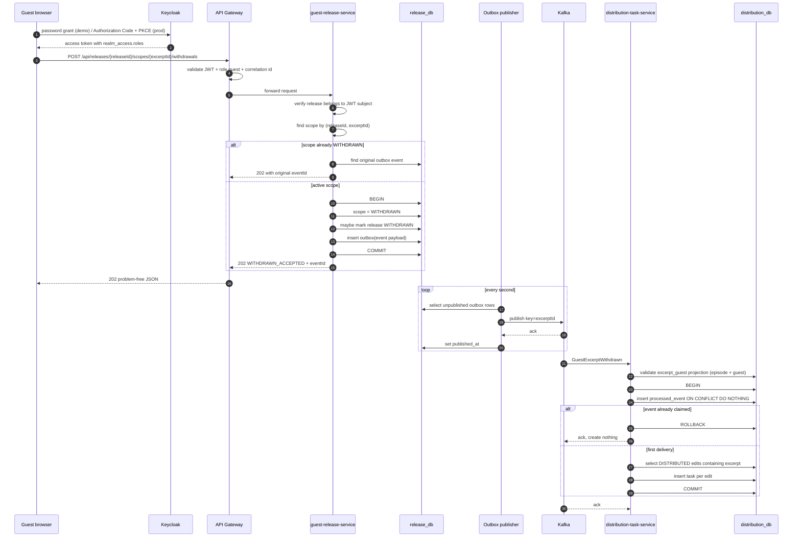
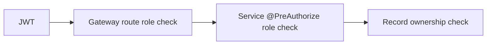

# Architecture

## System shape

Signal is a small service-oriented system with independently deployable
services, one database per service, Kafka for asynchronous fan-out, Keycloak
for identity, Eureka for discovery, and Spring Cloud Gateway as the public
edge.

| Component | Responsibility | Store |
| --- | --- | --- |
| `discovery-server` | Eureka registry | none |
| `api-gateway` | Routing, CORS, JWT role checks, correlation IDs | none |
| `podcast-excerpt-service` | Episodes, tagged excerpts, excerpt requests, in-app notifications | `excerpt_db` |
| `guest-release-service` | Releases, excerpt scopes, withdrawal decisions, outbox | `release_db` |
| `distribution-task-service` | Kafka consumption, idempotency, removal tasks | `distribution_db` |
| Keycloak | Realm roles and token issuance | Keycloak storage |
| Kafka | Durable event transport, retry and DLT topics | log storage |
| `web-dashboard` | Producer and guest UI | browser storage |

There are no shared tables and no cross-service foreign keys. The services
communicate synchronously over HTTP for reads and asynchronously over Kafka for
the withdrawal propagation.

## Why excerpt scopes

A guest release is a container, not the unit of consent. Each
`release_scope` row represents the guest's permission for one excerpt:

```text
guest_release 1 ─── n release_scope
                         │
                         └── excerpt_id (one tagged excerpt)
```

Withdrawing one scope:

1. updates only that scope row to `WITHDRAWN`,
2. records who withdrew it, when, and why,
3. leaves every sibling scope untouched,
4. marks the parent release `WITHDRAWN` only if no sibling scope remains
   `ACTIVE`.

The unique constraint `(release_id, excerpt_id)` prevents duplicate scopes for
the same excerpt in one release.

## Withdrawal flow



The API returns `202 Accepted` before Kafka publication. The client polls the
distribution read endpoint, or simply refreshes the guest dashboard, until the
three tasks appear.

## Seeded fan-out example

The target excerpt is attached to the YouTube, Spotify, and TikTok edits. The
control excerpt is attached to the YouTube, Social, TikTok, and Website edits.

```text
YouTube  ── target + control
Spotify  ── target
Social   ── control
TikTok   ── target + control
Website  ── control
```

Withdrawing **only the target excerpt** therefore creates exactly three removal
tasks (YouTube, Spotify, TikTok). The Social and Website edits are not touched,
and the control scope and its excerpt remain active. This is the invariant
enforced by the integration test and the smoke script.

## Excerpt request flow

```text
guest ──POST /requests──▶ excerpt_db (PENDING)
                              │
producer ──approve────────────┤ reuse ExcerptService.createExcerpt
                              │
                              ├─▶ excerpt row created
                              ├─▶ request APPROVED + excerptId
                              └─▶ notification event (guest)

producer ──reject─────────────┴─▶ request REJECTED + reason
                                  └─▶ notification event (guest)
```

Requests and decisions live in `excerpt_db`; no service is added. Approval and
rejection lock the pending row, so concurrent decisions cannot both succeed.
Approval calls the existing excerpt domain service rather than reimplementing
creation. It deliberately does not grant a release scope: consent stays at
excerpt scope and release granting remains the existing producer flow. The
guest UI surfaces approved excerpts without a release as **Awaiting release**.

## Notification flow

`notification` rows live in `excerpt_db` and are written directly when a
request is submitted or decided. Producer `CONSENT_WITHDRAWN` notifications are
derived by a listener from the existing `GuestExcerptWithdrawn` event. Guest
`TASK_COMPLETED` notifications are published best-effort by
`distribution-task-service` to `soa.s14.t04.notifications` and consumed by the
excerpt service; the unique `source_event_id` column makes replay a no-op.
Reads are scoped to the JWT subject; a notification belonging to another user
is a `404`.

This reuses the existing events topic and consumer conventions. There is no
notification microservice and no second outbox: the notification row is the
delivery record, and a failure to record one never fails a task update.

## Distribution task lifecycle

```text
OPEN ──▶ IN_PROGRESS ──▶ DONE
  └──────────────────────▶ (invalid, 409)
```

The producer may attach `notes` (max 4000) and an `evidenceUrl` (http/https,
max 2048) on any update. Every update records `updatedBy` from the JWT subject
and `updatedAt`; completion also records `completedAt`. `DONE` is an internal
record of producer completion, not proof of an external platform API call.
Guests can read tasks for their own excerpts but cannot update them.

## Consistency boundaries

| Boundary | Guarantee |
| --- | --- |
| Scope update + outbox insert | Atomic in one database transaction |
| Kafka publish | At least once; publisher retries until `published_at` is set |
| Consumer task writes | Atomic; `processed_event` and tasks commit together |
| Event application | Idempotent via atomic `processed_event` claim (`ON CONFLICT DO NOTHING`) |
| Task identity | Unique `(event_id, edit_id)` |
| Outbox identity | Unique `(aggregate_id, event_type)` |
| Scope identity | Unique `(release_id, excerpt_id)` |

Kafka consumers can see duplicates after rebalances, retries, or producer
resends. The consumer is deliberately idempotent rather than relying on
exactly-once semantics.

### Retry and dead letters

`@RetryableTopic` retries a failed consumer invocation up to three times with
exponential backoff, then routes the record to
`soa.s14.t04.events.DLT`. The DLT listener logs the record metadata and
payload. Invalid event type, missing identifiers, missing reason, and malformed
JSON are rejected before any database write and follow the same retry/DLT path.

## Security model



- Keycloak realm: `podcast-demo`.
- Roles: `podcastProducer`, `guest`.
- Gateway: coarse checks such as guest cannot POST producer routes.
- Services: `@PreAuthorize` role checks plus explicit ownership checks.
- Guest reads: release `guestId` must equal the JWT `sub`; excerpt guest must
  match the JWT `sub`.
- Producer reads: `produced_episode.producer_id` or `episode_owner.producer_id`
  must equal the JWT `sub`.
- The gateway and services validate signature, issuer, and the `podcast-api`
  audience (added to tokens by an audience mapper on the `podcast-dashboard`
  client), so a token minted for another API is rejected. Services fetch JWKS
  from Keycloak over the compose network using the internal hostname while
  validating the public issuer `http://localhost:8180/realms/podcast-demo`.

## Data ownership and projections

Each schema is private to its service. The release and distribution services
need a small amount of read data owned by other services:

- `produced_episode` in `release_db` answers "does this producer own the
  episode?"
- `excerpt_reference` in `release_db` validates excerpt membership and guest.
- `episode_owner` and `excerpt_guest` in `distribution_db` authorize task reads.

For the demo these are seeded directly by Flyway. A production implementation
would populate them from `EpisodeCreated`, `ExcerptTagged`, and
`ReleaseGranted` events, with replay and reconciliation. This trade-off is
intentional: it keeps the demo deterministic and focused on the withdrawal
workflow while still enforcing real record-level authorization.

## Observability

- `X-Correlation-Id` is generated at the gateway if absent and returned on the
  response.
- Servlet services put it in MDC and include it in log patterns.
- The event payload and Kafka headers carry the same correlation ID.
- Problem responses include `traceId` and `timestamp`.
- Actuator health endpoints back the Compose health checks.
- Eureka shows all five Spring applications registered.

## Failure modes

| Failure | Behavior |
| --- | --- |
| Release DB unavailable | Withdrawal fails atomically; no partial state |
| Kafka unavailable | 202 still returns; outbox retries later |
| Consumer down | Kafka retains the event; consumer catches up |
| Duplicate event | Consumer no-ops and acknowledges |
| Duplicate withdrawal request | Original event ID returned, no new outbox row |
| Invalid event | Retry then DLT; no task writes |
| Unknown release/scope | 404 problem details |
| Wrong guest/producer | 403 problem details |
| Expired/invalid token | 401 problem details from gateway |
| Token for another audience | 401 problem details from gateway |
| JWKS temporarily unreachable | Token validation fails until Keycloak recovers |

## Alternatives considered

- **Synchronous fan-out from release service** would make the withdrawal API
  depend on distribution availability and couple the services. Rejected.
- **Direct service-to-service HTTP for task creation** would require retries and
  still lack a durable buffering layer. Kafka plus outbox is simpler and
  auditable.
- **One release per excerpt** was rejected because the domain grant is issued per
  episode; scopes express per-excerpt consent inside that grant.
- **Exactly-once Kafka transactions** were unnecessary for this demo; an
  idempotent consumer covers replays with less operational complexity.
